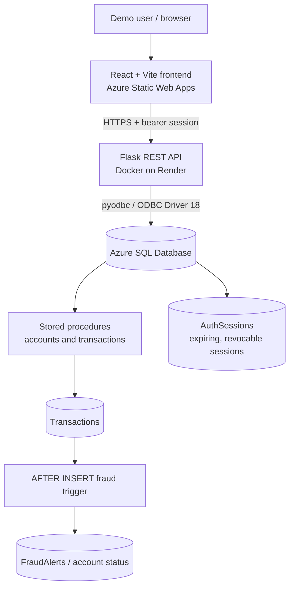
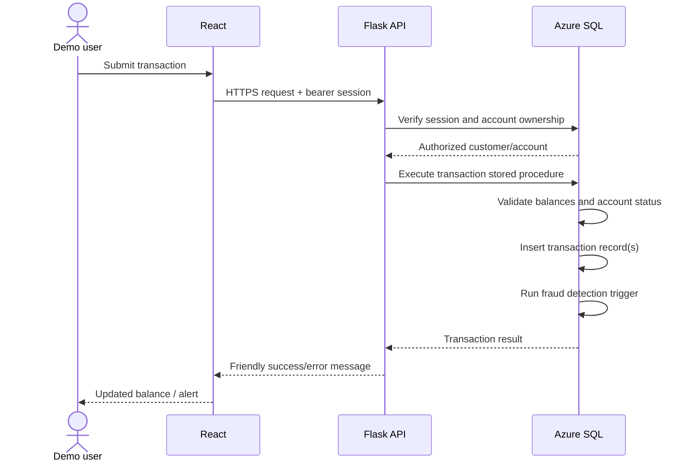

# 🏦 LAMA Bank

### Full-Stack Banking Simulation with Automated Fraud Detection

**React · Flask · Python · Microsoft SQL Server · Docker · Azure · Render**

[🌐 Live Application](https://victorious-stone-0ee0f6c10.7.azurestaticapps.net/) · [⚙️ API Status](https://lama-banking-api.onrender.com/) · [📁 Source Repository](https://github.com/landezubenathi/banking-system)

> **Educational portfolio project:** LAMA Bank simulates banking transactions using demonstration balances. It is **not** a financial institution and does **not** move real funds. Use fictional identities and demo data only. The project has undergone developer-performed functional and authorization checks, not an independent penetration test or financial-sector security certification.

## Overview

LAMA Bank is a full-stack banking simulation that connects a React frontend to a Python Flask REST API and a Microsoft SQL Server database. It models customer accounts, deposits, withdrawals, transfers, transaction history and rule-based fraud detection. SQL Server stored procedures handle core banking operations, while a database trigger flags high-value activity and freezes affected demo accounts.

The project demonstrates **full-stack application development, API design, SQL business logic, backend access control, cloud hosting and CI/CD**.

## Live deployment

| Layer | Technology | Hosting |
| --- | --- | --- |
| Frontend | React 18, JavaScript, Vite 5, React Router, Axios | [Azure Static Web Apps](https://victorious-stone-0ee0f6c10.7.azurestaticapps.net/) |
| Backend API | Python 3.12, Flask, Gunicorn | [Render Docker Web Service](https://lama-banking-api.onrender.com/) |
| Database | Microsoft SQL Server / T-SQL | Azure SQL Database |
| Database connectivity | `pyodbc` and Microsoft ODBC Driver 18 | Flask → Azure SQL |
| CI/CD | GitHub Actions | Frontend build and deployment |

The free Render instance may take additional time to respond after inactivity.

## Application features

- **Customer registration and login** — register a demo profile; passwords are hashed with Werkzeug.
- **Session-based authorization** — Flask validates an expiring server-side session against `AuthSessions` in Azure SQL; logout revokes the session.
- **Dashboard** — account information, demo balances, recent activity and a **last successful login** timestamp.
- **Account management** — generated **10-digit account numbers** and ACTIVE/FROZEN account statuses.
- **Deposits and withdrawals** — stored-procedure-backed simulated transactions with validation and account-specific user-friendly errors.
- **Account-number transfers** — users send simulated funds to a **7–10 digit recipient account number**, not an internal database ID.
- **Transaction history** — retrieve transactions and related account numbers.
- **Fraud alerts** — a SQL Server trigger flags transactions over **R10,000**, logs an alert and freezes affected demo accounts.
- **Ownership checks** — Flask checks account/customer ownership on protected routes; customers cannot initiate transfers from another customer's account.
- **Usability** — registration-to-login navigation, meaningful frozen-account messages, and deep-link/refresh support for React routes.

## System architecture



### Account ID vs. account number

The application keeps internal database keys separate from customer-facing account numbers:

| Database field | Example | Use |
| --- | --- | --- |
| `Accounts.AccountId` | `9` | Internal primary key and transaction relationships |
| `Accounts.AccountNumber` | `1000000009` | Displayed to customers and used for transfers |
| `Transactions.ReferenceAccountId` | `5` | Internal reference to the other account in a transfer |

`dbo.TransferMoney` accepts account-number strings and resolves them to internal IDs in SQL. Account numbers remain strings to preserve their formatting. Current `VARCHAR(10)` storage supports **7–10 digits**; extending the length requires a coordinated schema and validation update.

## Banking and fraud workflow



**Fraud rule:** The trigger treats amounts **greater than R10,000** as suspicious. Because transfer history is represented by entries for both accounts, high-value transfers can currently flag both sides; this is a known business-rule limitation to consider when evolving the fraud model. Fraud detection is **rule-based T-SQL**, not machine learning.

## Database design

| Table | Purpose |
| --- | --- |
| `Customers` | Customer profile data |
| `Users` | Usernames and password hashes |
| `Accounts` | Demo balances, account numbers and statuses |
| `Transactions` | Deposits, withdrawals and simulated transfers |
| `FraudAlerts` | Detected suspicious activity |
| `AuthSessions` | Hashes of issued session tokens, expiration and revocation |

The `database/` folder includes table definitions, stored procedures, the fraud trigger, a verification seed script and an authentication-session migration. **Existing production/demo Azure SQL databases should be migrated using reviewed scripts, not by rerunning every CREATE TABLE file.** The repository is not currently an automated fresh-install migration framework.

## API overview

| Method | Endpoint | Purpose |
| --- | --- | --- |
| `GET` | `/` | API availability response |
| `POST` | `/register` | Register a demo user (may be disabled) |
| `POST` | `/login` | Verify credentials and issue session |
| `POST` | `/logout` | Revoke current session |
| `GET` | `/profile/<customer_id>` | Get current customer's profile |
| `PUT` | `/profile` | Update current customer's profile |
| `POST` | `/create-account` | Create an account for the current customer |
| `GET` | `/accounts/<customer_id>` | List current customer's accounts |
| `POST` | `/deposit` | Simulated deposit |
| `POST` | `/withdraw` | Simulated withdrawal |
| `POST` | `/transfer` | Simulated account-number transfer |
| `GET` | `/transactions/<account_id>` | Transactions for an owned account |
| `GET` | `/recent-transactions/<customer_id>` | Recent transactions |
| `GET` | `/fraud-alerts/<customer_id>` | Current customer's fraud alerts |

Protected endpoints require a valid bearer session. The former `/toggle-account-status` self-service operation is denied; changing a frozen status requires a separate authorized review workflow.

## Repository structure

```text
banking-system/
├── .github/workflows/           # GitHub Actions workflows
├── backend/
│   ├── app.py                   # Flask app, CORS, route registration
│   ├── db.py                    # SQL Server connection
│   ├── security.py              # Session verification and ownership helpers
│   ├── routes/                  # Auth, account, transaction, fraud routes
│   ├── services/                # Application business logic
│   ├── Dockerfile               # Render deployment with ODBC Driver 18
│   └── requirements.txt
├── database/
│   ├── tables/
│   ├── Procedures/
│   ├── triggers/
│   ├── migrations/              # AuthSessions migration
│   └── seed/                    # Database verification
├── frontend/
│   ├── public/staticwebapp.config.json
│   ├── src/pages/
│   ├── src/components/
│   ├── src/services/api.js      # Axios and session header
│   ├── package.json
│   └── vite.config.js
├── docs/
└── README.md
```

## Documentation

For more detail, see the dedicated project documents:

| Document | Description |
| --- | --- |
| [Architecture](docs/ARCHITECTURE.md) | React–Flask–Azure SQL system design, authentication, transactions and fraud workflow |
| [Setup & deployment](docs/SETUP.md) | Local installation, database prerequisites, Render and Azure configuration |
| [Testing & quality assurance](docs/TESTING.md) | Functional test cases, authorization checks, expected results and known limitations |
| [Screenshot guidelines](docs/screenshots/README.md) | How to add safe, real demo screenshots without publishing private data |

## Run locally

### Requirements

- Python **3.12** (the Docker environment uses 3.12)
- Node.js and npm compatible with Vite 5
- Microsoft SQL Server or Azure SQL Database with the required schema/procedures
- Microsoft ODBC Driver **18** for SQL Server

### Backend

```bash
git clone https://github.com/landezubenathi/banking-system.git
cd banking-system/backend
python -m venv .venv
# Windows PowerShell: .venv\Scripts\Activate.ps1
# macOS/Linux: source .venv/bin/activate
pip install -r requirements.txt
python app.py
```

Create `backend/.env` locally (never commit it):

```dotenv
DB_DRIVER=ODBC Driver 18 for SQL Server
DB_SERVER=your-server.database.windows.net
DB_NAME=your_database_name
DB_USER=your_database_user
DB_PASSWORD=your_database_password
DB_TRUSTED_CONNECTION=no
CORS_ORIGINS=http://localhost:5173
FLASK_DEBUG=False
REGISTRATION_ENABLED=false
```

Apply the `AuthSessions` migration and required stored procedures/triggers to your own development database before testing login and transactions. To test registration, explicitly set `REGISTRATION_ENABLED=true` **for a controlled local environment**.

### Frontend

In another terminal:

```bash
cd banking-system/frontend
npm install
npm run dev
```

Create `frontend/.env`:

```dotenv
VITE_API_URL=http://127.0.0.1:5000
```

Vite embeds `VITE_API_URL` at **build time**. Never put SQL credentials, session signing secrets or private keys into `VITE_` variables.

## Deployment notes

- **Frontend:** Azure Static Web Apps builds from `/frontend` and publishes `dist`; the GitHub Actions workflow supplies the Render URL as `VITE_API_URL` during the build.
- **React routes:** `frontend/public/staticwebapp.config.json` rewrites application page requests to `/index.html`, allowing direct links and browser refresh on `/login`, `/dashboard`, etc.
- **Backend:** Render deploys `backend/Dockerfile`, installing the Microsoft SQL Server ODBC 18 driver and running Flask via Gunicorn.
- **Database:** Azure SQL is reached through firewall rules restricted to Render's documented outbound ranges.
- **Configuration:** Use Render environment variables for private database credentials. Restrict Flask CORS origins to the actual frontend domain. Avoid operating a second, unused Azure App Service plan unnecessarily.

## Testing and security scope

The developer reports successful live functional testing of **10 application areas** and **6 targeted security scenarios**, including login, account operations, fraud alerts, authorization checks and session logout. Recent updates additionally verified account-number transfers, successful-login timestamps, frozen-account feedback and refreshing nested React pages.

These results document the project's testing progress, **not a certification that the app is safe for real banking or personal data**.

Remaining areas for improvement include login rate limiting, safer browser token storage (currently `sessionStorage`), automated integration tests, concurrency/deadlock testing, monitoring, stronger fraud review workflows and privacy audits. Use **synthetic identities only** in screenshots, seed data and public demos; review Git history for accidentally committed credentials or personal data.

## Screenshots

Add screenshots with synthetic demo information under `docs/screenshots/` before enabling Markdown image embeds:

- `login.png` — login page
- `dashboard.png` — account overview and last login
- `transfer.png` — transfer form using account numbers
- `transactions.png` — transaction history
- `fraud-alerts.png` — automatic fraud alert and frozen status

See [`docs/screenshots/README.md`](docs/screenshots/README.md) for a privacy checklist. **No screenshots are embedded yet, to avoid broken links or publishing real user information.**

## Contributors

- **Liyabona Mafusini**
- **Zubenathi Lande**

Software Development graduates, Walter Sisulu University.

---

**LAMA Bank is a learning and portfolio demonstration, not a licensed banking service. No real funds are transferred.**
