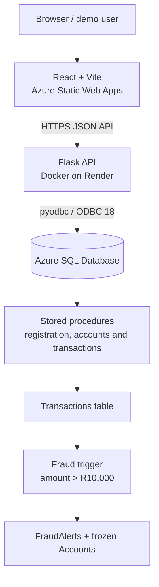

# LAMA Bank — Banking Simulation with Automated Fraud Detection

**Live Demo:** [LAMA Bank on Azure Static Web Apps](https://victorious-stone-0ee0f6c10.7.azurestaticapps.net/)  
**API:** [Flask API on Render](https://lama-banking-api.onrender.com/)  
**Source:** [GitHub — banking-system](https://github.com/landezubenathi/banking-system)

> **Educational project / demo balances only.** This application is **not a bank**, does not move real money, and must not be used with real financial or identity information. The source in the provided repository ZIP does **not** implement server-side bearer-token/session authorization for its customer-specific and money-moving endpoints. Do not present it as production-secure or offer unrestricted public sign-ups until this is resolved. See [Security findings](SECURITY_FINDINGS.md).

## About the project

LAMA Bank is a full-stack banking simulator built with **React + Vite**, **Python/Flask**, and **Microsoft SQL Server**. It demonstrates banking workflows supported by SQL Server stored procedures, plus rule-based fraud alerting implemented using an `AFTER INSERT` transaction trigger. The frontend is hosted on Azure Static Web Apps; the Flask API runs in Docker on Render and connects over ODBC Driver 18 to Azure SQL Database.

The author reports passing end-to-end functional tests for login, dashboard, accounts, deposits, withdrawals, transfers, transaction history, profile editing, and fraud alerts. These are project-level functional tests, **not** a formal security audit.

## Features

- Register customer accounts with hashed passwords (`werkzeug.security`).
- Sign in to the banking simulation and view an account dashboard.
- Create customer bank accounts with unique, generated **10-digit account numbers**.
- Simulate deposits and withdrawals with SQL stored procedures.
- Transfer simulated funds **using 7–10 digit account numbers** (after applying the migration in this package).
- Record both sides of simulated transfers and display the related bank account number in transaction history.
- Show balances, account status, transaction history, profile information and customer fraud alerts.
- Detect simulated transactions over **R10,000** with a SQL Server trigger that creates fraud alerts and freezes affected accounts. For a transfer, both account transaction entries can trigger alerts/freeze because both are inserted.
- Deploy via GitHub Actions (React) and a Docker web service (Flask).

## Technology stack

| Layer | Technology |
| --- | --- |
| Frontend | React 18, JavaScript, Vite 5, React Router 6, Axios |
| Backend | Python 3.12, Flask, Gunicorn, Flask-CORS, Werkzeug |
| Database | Azure SQL Database / Microsoft SQL Server, T-SQL |
| SQL connection | pyodbc, Microsoft ODBC Driver 18 |
| Backend hosting | Render Docker Web Service |
| Frontend hosting | Azure Static Web Apps |
| CI/CD | GitHub Actions, Azure Static Web Apps deploy action |

## Architecture



## How transfers work (account-number update)

The database distinguishes **internal IDs** from **customer-facing numbers**:

| Field | Example | Purpose |
| --- | --- | --- |
| `Accounts.AccountId` | `7` | Internal primary key / foreign keys |
| `Accounts.AccountNumber` | `1000000007` | Customer-facing account number |
| `Transactions.AccountId` | `7` | Internal transaction/account relationship |
| `Transactions.ReferenceAccountId` | `8` | Related internal account in a transfer |

The transfer screen now sends number **strings**, not numeric IDs:

```json
{
  "from_account": "1000000007",
  "to_account": "1000000008",
  "amount": 25.00
}
```

`dbo.TransferMoney` resolves the two account numbers to internal IDs and performs an atomic transaction. `DepositMoney`, `WithdrawMoney`, the fraud trigger, and internal foreign keys **continue using AccountId**. This is deliberate and avoids rewriting historical data.

**Current limit:** `Accounts.AccountNumber` is `VARCHAR(10)`, so inputs are validated for **7–10 digits**. To support more than 10 digits, extend the column size, generation logic, validations, and migration as a separate change.

## Repository layout

```text
banking-system/
├── .github/workflows/       # Azure Static Web Apps CI/CD and old Azure API workflow
├── backend/
│   ├── app.py               # Flask app, CORS and route registration
│   ├── db.py                # pyodbc connection via environment variables
│   ├── Dockerfile           # Python 3.12 + ODBC Driver 18 + Gunicorn
│   ├── routes/              # auth, account, transaction and fraud endpoints
│   └── services/            # data access and transaction business flow
├── database/
│   ├── tables/
│   ├── Procedures/          # includes TransferMoney.sql
│   ├── triggers/fraud_trigger.sql
│   └── seed/seed.sql        # verification queries, not sample credentials
├── frontend/
│   ├── src/pages/           # login, registration, dashboard, banking and profile
│   ├── src/components/
│   ├── src/services/api.js  # axios + VITE_API_URL
│   ├── package.json
│   └── vite.config.js
├── TESTING.MD
└── README.md
```

## API overview

| Method | Endpoint | Purpose |
| --- | --- | --- |
| `GET` | `/` | API health/landing JSON |
| `POST` | `/register` | Create customer profile and demo account |
| `POST` | `/login` | Check username and password hash |
| `POST` | `/logout` | Update stored last-login field (not server-side session revocation) |
| `GET` | `/profile/<customer_id>` | Customer profile |
| `PUT` | `/profile` | Edit customer profile |
| `POST` | `/create-account` | Create account |
| `GET` | `/accounts/<customer_id>` | List customer accounts |
| `POST` | `/toggle-account-status` | Toggle frozen/active status |
| `POST` | `/deposit` | Simulated deposit (internal AccountId) |
| `POST` | `/withdraw` | Simulated withdrawal (internal AccountId) |
| `POST` | `/transfer` | Simulated transfer (**account-number strings**) |
| `GET` | `/transactions/<account_id>` | History (internal AccountId), now includes related account number |
| `GET` | `/recent-transactions/<customer_id>` | Recent activity |
| `GET` | `/fraud-alerts/<customer_id>` | Customer fraud alerts |

> **Security limitation:** These routes currently do not verify a signed session or bearer token against the requesting customer. Hiding routes in React or putting `customer_id` in localStorage is not access control. Do not share accounts with actual personal data, and do not call the demo production-grade.

## Local development

### Prerequisites

- Python 3.12 (used by the Render Dockerfile).
- Node.js 22 or another version compatible with the project's Vite version.
- SQL Server (local or Azure SQL) and a compatible SQL Server ODBC driver.
- A configured SQL database containing the tables, procedures and trigger.

### Backend

```bash
cd backend
python -m venv .venv
# Windows: .venv\Scripts\activate
# Linux/macOS: source .venv/bin/activate
pip install -r requirements.txt
python app.py
```

Create `backend/.env` based on `.env.example`, with the SQL connection settings below. **Never commit `.env`**:

```dotenv
DB_DRIVER=ODBC Driver 18 for SQL Server
DB_SERVER=your-server.database.windows.net
DB_NAME=BankingSystemAndFraudDetectonDB
DB_USER=your-sql-user
DB_PASSWORD=your-sql-password
DB_TRUSTED_CONNECTION=no
FLASK_DEBUG=False
```

`backend/db.py` reads these environment values. The provided source defaults to Driver 17, so set `DB_DRIVER` explicitly to Driver 18 when using its Dockerfile.

### Frontend

```bash
cd frontend
npm install
npm run dev
```

Create `frontend/.env`:

```dotenv
VITE_API_URL=http://127.0.0.1:5000
```

The production React workflow sets `VITE_API_URL=https://lama-banking-api.onrender.com` **at build time**. The Vite build outputs into `frontend/dist`.

## SQL database and migrations

Use `database/Procedures/TransferMoney.sql` to update an **existing** Azure SQL database with the account-number transfer implementation. The source-controlled change alone does not update a live Azure database. Use SSMS or another SQL deployment workflow to run it after backing up the database.

**Do not execute `database/tables/Accounts.sql` against the existing database**: it is a reference `CREATE TABLE` for new schemas. The previously supplied live database already had `AccountNumber` and a unique constraint; the ZIP's original `Accounts.sql` was missing the column, so this package corrects its definition.

This `database/` folder is **not yet a fully automated clean-install migration set**. For example, `ToggleAccountStatus` is called by Flask but does not have its own procedure file in the supplied repository. Review all table/procedure dependencies before provisioning a fresh SQL Server from these scripts. The current hosted database is the functional reference.

## Fraud-detection rules

`database/triggers/fraud_trigger.sql` observes new rows added to `Transactions`. For inserted transactions with `Amount > 10000`, it sets the associated account status to `FROZEN` and creates an `ACTIVE` entry in `FraudAlerts`.

The trigger uses internal `Transactions.AccountId`; therefore the account-number transfer update **does not require changing this trigger**. It does not implement machine learning, velocity detection or other advanced fraud rules.

## Deployment

1. Host the Flask `backend/` directory as a **Docker** web service on Render, using `backend/Dockerfile`.
2. Configure Render environment variables for Azure SQL (do not store secrets in GitHub).
3. Allow Render's documented outbound IP ranges in the Azure SQL server firewall.
4. Confirm the API root responds on the Render URL and test database-backed endpoints with demo credentials.
5. The GitHub Actions workflow `.github/workflows/azure-static-web-apps-victorious-stone-0ee0f6c10.yml` deploys `frontend/` to Azure Static Web Apps, with `output_location: dist` and production `VITE_API_URL` set in its build-step environment.
6. Ensure Flask CORS allows the Azure Static Web App's **origin** (without a path/trailing slash).

Render's free instances can sleep while idle; Azure SQL costs and firewall settings are managed separately. The ZIP contains an older Azure App Service backend workflow alongside the working Render setup; disable the old deployment workflow if Azure App Service is no longer used.

## Testing

See [Account-number migration and QA guide](ACCOUNT_NUMBER_MIGRATION_GUIDE.md) for the safe deployment order and test cases. Run account-number tests with **synthetic demo accounts only**, verifying success and rollback cases. These changes have been reviewed and unit-tested without a live Azure SQL integration test in this workspace.

## Known limitations / planned improvements

- **Priority 1:** Add server-side authentication, verified customer ownership checks, and authorization for every sensitive route. Use secure session management/token expiry and revoke sessions on logout. See [Security findings](SECURITY_FINDINGS.md).
- Use a staged migration strategy and add automated integration tests for Azure SQL stored procedures.
- Audit all database bootstrap scripts for completeness and add missing stored procedure definitions.
- Fix the sidebar logout request (its current source references undeclared `API`/`user` variables, although it clears localStorage).
- Define operational limits and test concurrent transfers, deadlocks, account status changes and high-value transfer behavior.
- Improve error reporting and accessibility while keeping sensitive internal details out of API responses.

## Contributors

The existing README credits **Liyabona Mafusini** and **Zubenathi Lande**. This rewrite retains that attribution.

---

**LAMA Bank is a software engineering portfolio project, not an actual financial institution.**
