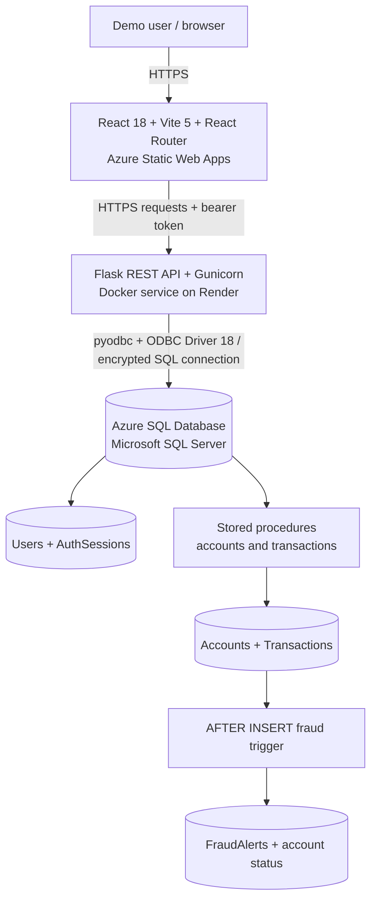
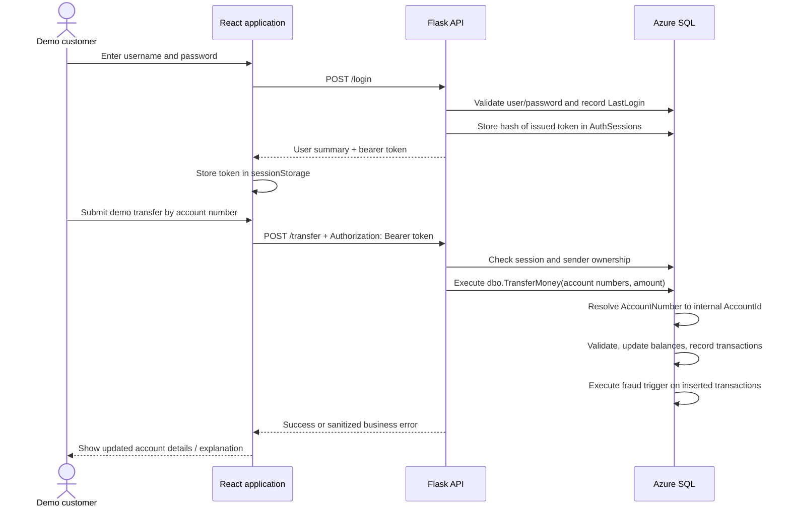
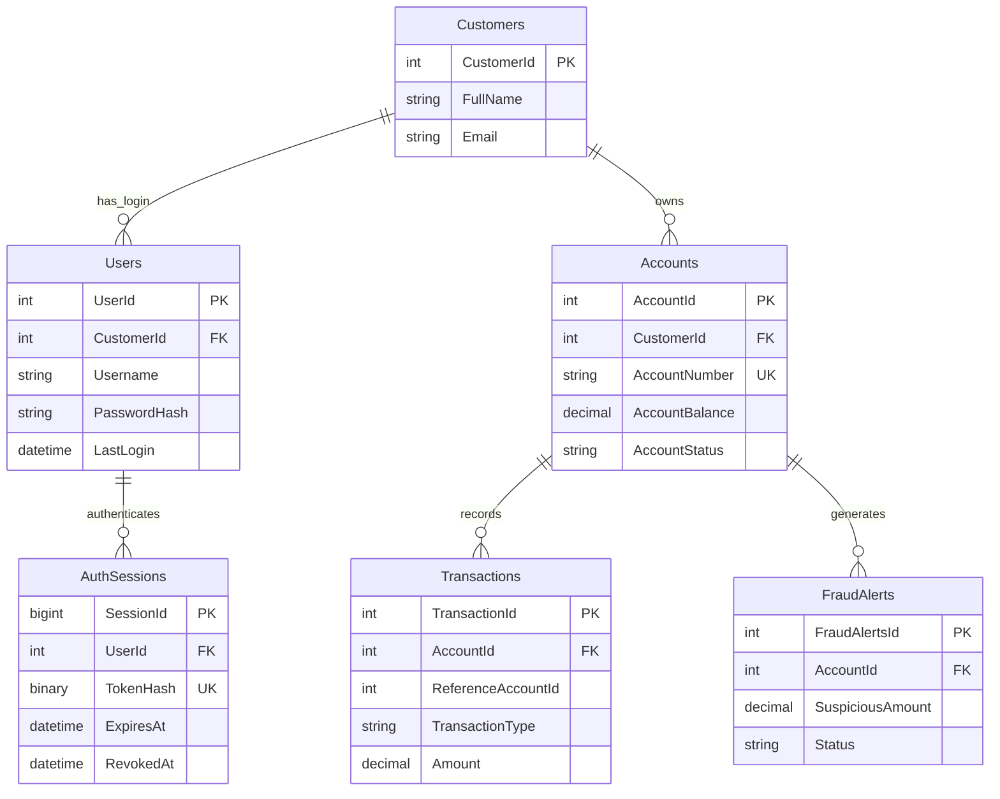

# System Architecture — LAMA Bank

[← Main README](../README.md) · [Local setup](SETUP.md) · [Testing](TESTING.md)

## Purpose and scope

LAMA Bank is an **educational banking simulation** developed with React, Flask and Microsoft SQL Server. It demonstrates login, account management, simulated deposits, withdrawals, transfers, transaction history and rule-based fraud detection. It is **not a real bank** and does not process real money.

This document describes the deployed project as implemented and tested by the developers. It is not a claim of production-grade financial security.

## Deployed system

**Public links:** [Frontend](https://victorious-stone-0ee0f6c10.7.azurestaticapps.net/) · [API health endpoint](https://lama-banking-api.onrender.com/) · [Repository](https://github.com/landezubenathi/banking-system)

| Layer | Implementation | Responsibilities |
| --- | --- | --- |
| Frontend | React, React Router, Axios, CSS, Vite | Forms, dashboard, input validation, account-number display, navigation, user feedback |
| Backend | Python 3.12, Flask, Flask-CORS, Gunicorn | API endpoints, authentication, session validation, ownership checks, business-logic orchestration |
| Data access | `pyodbc` + ODBC Driver 18 | Parameterized connections and execution of SQL statements / stored procedures |
| Database | Azure SQL Database, T-SQL | Customer/account persistence, transactional money simulation, fraud rules, session records |
| Hosting / CI | Azure Static Web Apps, Render (Docker), GitHub Actions | HTTPS hosting, automated builds/deploys, environment configuration |

## Browser-to-database request flow

### Authentication and authorization

- The login service checks the password hash and issues a random token on success.
- `AuthSessions` records a **SHA-256 hash** of each bearer token, a creation time, expiry time and optional revocation time; the current implementation issues **2-hour** sessions.
- The browser currently holds the token in `sessionStorage` and adds it to API requests using Axios. Backend routes check the token against Azure SQL.
- Protected routes compare the verified customer identity with customer/account ownership in SQL. A recipient of a transfer may be someone else, but the sender must belong to the authenticated customer.
- Logout revokes the token. The old self-service `/toggle-account-status` behavior is denied; frozen accounts require a separate authorized review.

**Security boundary:** React route guards improve usability; they are **not** the security control. Flask authorization and SQL checks are essential. Browser token storage, login rate limiting, abuse protection, security testing and data privacy require continued attention before unrestricted public use.

## Data model

The diagram is a **logical overview**; check the T-SQL definitions for the exact constraints and column types. `ReferenceAccountId` is used to refer to the other internal account involved in a transfer.

### Account number vs. internal ID

| Value | Example | Used by |
| --- | --- | --- |
| `Accounts.AccountId` | `9` | Internal primary key, joins and transaction/fraud relationships |
| `Accounts.AccountNumber` | `1000000009` | Customer-facing identifiers and transfer inputs |

New account numbers are generated as **10-digit strings**. The current account-number validation accepts **7–10 numeric characters** (the database column is `VARCHAR(10)`). Account numbers should remain strings end-to-end. `dbo.TransferMoney` resolves them to internal account IDs before recording the transaction.

### Stored procedures and fraud behavior

- `CreateCustomerProfile`, `UserLogin` and `UpdateProfile` support customer management.
- `CreateAccount` creates a new demo account and generates its account number.
- `DepositMoney`, `WithdrawMoney` and `TransferMoney` validate and record simulated transactions.
- `GetCustomerRecentTransactions` retrieves recent demo activity.
- `trg_FraudAlerts` runs **after transactions are inserted** and flags amounts **greater than R10,000**; it records a fraud alert and marks the affected account frozen.

**Known rule limitation:** The current transfer logic records a transaction row for each side of a transfer. For a large transfer, the trigger may flag/freeze **both accounts**. This is a rule-based SQL demo (not an ML fraud detection model) and is a known area for future refinement.

## Deployment and navigation

- **Azure Static Web Apps:** GitHub Actions builds the project in `/frontend` and publishes `dist`. `VITE_API_URL` is supplied **at build time** and points to the Render backend.
- **React Router:** `frontend/public/staticwebapp.config.json` rewrites deep links to `/index.html`; this makes `/login`, `/dashboard`, `/transfer` and other pages refresh successfully.
- **Render:** `backend/Dockerfile` installs Python dependencies, Microsoft ODBC Driver 18 and starts Gunicorn on the configured `PORT` (default 10000).
- **Azure SQL:** SQL Server firewall rules permit Render's documented outbound IP ranges; connection details are stored as Render environment variables, not in frontend code.
- **CORS:** Flask accepts the configured frontend origin and the local development origin.

## Risks and operational considerations

1. **Demo only:** use fictional accounts, simulated balances and synthetic identities. Do not advertise this as a licensed banking product.
2. **Data exposure:** search the current repository **and Git history** for secrets and personal data before making it public. Remove sensitive data and rotate compromised credentials.
3. **Access control:** protect every customer/account route server-side; retain the blocked status-toggle endpoint.
4. **Hosting limits:** Render's free instances can spin down and take time to restart; Azure SQL usage may incur charges.
5. **Testing:** the project's reported functional checks are developer-performed, not an independent audit. See [TESTING.md](TESTING.md).

---

**Contributors:** Liyabona Mafusini and Zubenathi Lande.
